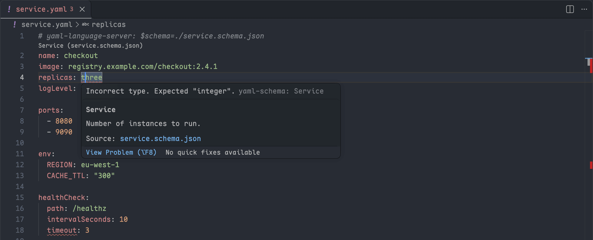
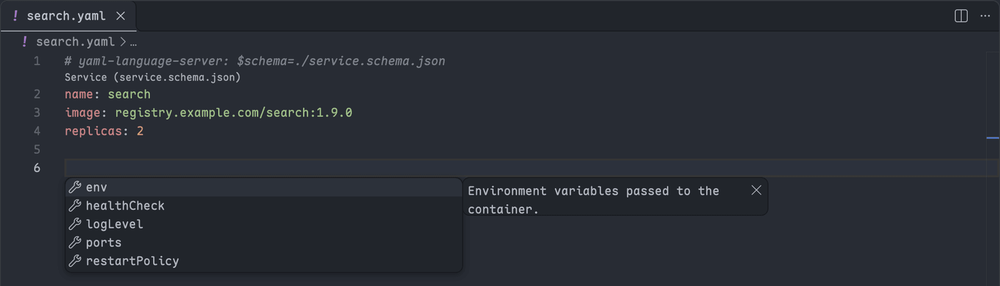
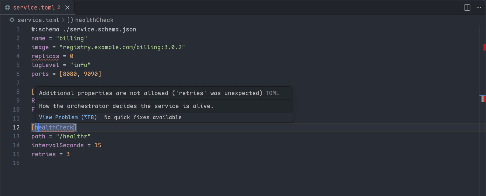
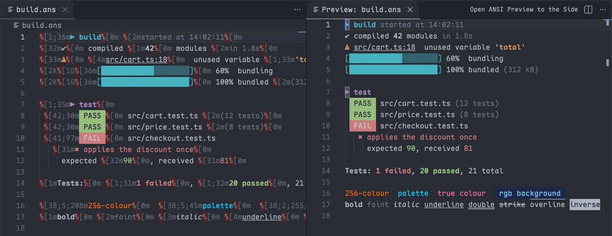

# Editor Lang Toolkit

[](https://marketplace.visualstudio.com/items?itemName=HeavenSky.editor-lang-toolkit)
[](https://marketplace.visualstudio.com/items?itemName=HeavenSky.editor-lang-toolkit)
[](./LICENSE.txt)

[English](./README.md) · **简体中文**

> 市场页只渲染英文版 README, 不随访问者的显示语言切换; 插件界面本身是双语的.

**YAML**, **TOML** 与 **ANSI 着色文本**的语言支持 —— schema 校验, 补全, 悬停提示, 格式化, 导航, 以及终端颜色. 另外支持调试用 uv 管理的 **Python** 项目.

两个语言服务器都已打包在内. 不需要安装任何 CLI 工具, 不需要配置工具链, 也没有遥测.

---

## 为什么需要它

VS Code 内置了完整的 JSON 语言服务. 对 YAML 只提供了 TextMate 语法. 对 TOML 则什么都没有.

|                    | JSON | YAML     | TOML     |
| ------------------ | ---- | -------- | -------- |
| 内置语法高亮       | 有   | 有       | **无**   |
| 内置语言服务       | 有   | **无**   | **无**   |
| 本扩展提供         | —    | **有**   | **有**   |

多数填补这些空缺的扩展都要求先装一个二进制 —— `taplo`, `buf`, 某个格式化器, 某个 linter. 对**工具**类扩展来说这很合理, 对**语言**类扩展则不然: 打开一个配置文件, 就该直接可用.

---

## 功能

### YAML

基于内置的 [yaml-language-server](https://github.com/redhat-developer/yaml-language-server).

**校验**

- JSON Schema, draft-04 / 07 / 2019-09 / 2020-12
- 未使用的锚点检测
- flow 风格规则 (`yaml.style.flowMapping`, `yaml.style.flowSequence`)
- 映射键顺序 (`yaml.keyOrdering`)
- Kubernetes CRD schema



**Schema 发现** —— 四种途径, 按优先级:

1. modeline: `# yaml-language-server: $schema=<url>`
2. 文档内的 `$schema` 属性
3. `yaml.schemas` 设置
4. [SchemaStore](https://www.schemastore.org/) 目录, 按文件名自动匹配

**编辑** —— 补全, 悬停提示, 文档符号, 折叠, 锚点跳转定义, 重命名, 文档链接, 智能选区, 快速修复, CodeLens, 格式化与输入时格式化.



### TOML

基于内置的 [Taplo](https://github.com/tamasfe/taplo) WebAssembly 构建.

- 语法高亮与语义 token
- JSON Schema 校验, 关联可来自 `.taplo.toml` 或设置
- 补全, 悬停提示, 文档符号, 折叠, 重命名, 文档链接
- 格式化, 可通过 `.taplo.toml` 或 `langToolkit.taplo` 设置调整



工作区里的 `.taplo.toml` 会被自动读取 —— 与 `taplo` CLI 是同一份文件, 因此编辑器与 CI 天然一致, 不需要维护两份配置.

### ANSI

抓取下来的终端输出会按其真实颜色渲染, 而不是显示成一堆转义码.

- **完整的 SGR 覆盖** —— 16 色及其亮色变体, 256 色 (`38;5;n`) 与**真彩色** (`38;2;r;g;b`); 粗体, 弱化, 斜体, 下划线, 双下划线, 删除线, 上划线, 反色与隐藏
- **颜色跟随主题** —— 映射到 VS Code 的 `terminal.ansi*` 调色板, 无需任何配置, 也不必跟着配色方案手动同步
- **控制序列被正确识别而不是渲染成乱码** —— 光标移动与清行会被淡化处理. 这比听起来重要: 进度条, spinner 与 `docker build` 的输出几乎全由它们构成
- **预览打开的是真正的编辑器**, 不是 webview —— 搜索, 选择, 复制与并排滚动都照常可用, 因为它本来就是编辑器



着色作用于 `ansi` 语言 (`.ans`, `.ansi`). 要覆盖其他文件:

```jsonc
{ "files.associations": { "*.log": "ansi" } }
```

代价是失去内置 `log` 语法的时间戳着色. 当文件里确实含转义码时这是划算的 —— 那种情况下内置语法本来也只会把它们渲染成噪声.

### Python 调试 (uv)

如果你的 Python 项目已经在用 [uv](https://docs.astral.sh/uv/), 不装微软的 Python 扩展也能在 VS Code 里调试. 调试器经由你已有的 uv 启动, 编辑侧用什么都可以 —— `ty`, `ruff`, 或者什么都不用.

- **在 `.py` 文件里直接按 F5** —— 不需要 `launch.json`; 当前文件带断点运行, 支持单步, 变量, 监视与调试控制台
- **原样使用项目环境** —— 程序运行在 `uv run` 为工作目录解析出的环境里, 项目依赖照常 import. `debugpy` 由 `uv run --with debugpy` 临时带上, 不会加进你的项目
- **`launch.json` 模板** —— *Python (uv): 当前文件*, *模块* (`python -m`) 与 *附加到 debugpy*; 额外的 `uv run` 参数写在 `uvArgs`, 例如 `["--with", "requests"]`

```jsonc
{ "name": "Python (uv): Current File", "type": "uvpy", "request": "launch", "program": "${file}" }
```

---

## 环境要求

YAML, TOML 与 ANSI 无任何要求, 两个语言服务器都已打包在内.

Python 调试使用你自己的 `uv` —— 从 `PATH` 或常见安装位置查找, 也可以在调试配置里设置 `uvPath`.

---

## 命令

全部命令位于命令面板的 **Lang Toolkit** 分类下.

| 命令 | 说明 |
| --- | --- |
| `重启语言服务器` | 重启两个服务器, 不需要重载窗口 |
| `检查 TOML 语法更新` | 立刻检查一次, 不等每周的自动检查 |
| `打开 ANSI 预览` | 以剥离转义序列后的形态打开当前文件 |
| `在侧边打开 ANSI 预览` | 同上, 并排显示 |

---

## 设置

| 设置项 | 默认值 | 说明 |
| --- | --- | --- |
| `langToolkit.yaml.enabled` | `true` | 启用 YAML 语言服务器. 语法高亮不受影响. |
| `langToolkit.toml.enabled` | `true` | 启用 TOML 语言服务器. 语法高亮不受影响. |
| `langToolkit.taplo` | `{}` | 传给 Taplo 的设置, 键名 camelCase. 见 [Taplo 配置文档](https://taplo.tamasfe.dev/configuration/file.html). |
| `langToolkit.toml.grammarUpdate.enabled` | `true` | 每周在后台检查 TOML 语法是否有新版. |
| `langToolkit.toml.grammarUpdate.url` | 上游语法地址 | 语法文件的来源. |

YAML 的 schema 关联沿用标准的 `yaml.schemas` 与 `yaml.schemaStore.*` —— 这些键由 `yaml-language-server` 直接读取, 已有配置无需改动.

ANSI 着色**没有任何设置项**, 颜色来自你的主题.

---

## 网络访问

有三处会访问网络. 每一处都可以避开, 且都不会发送与你有关的任何信息.

| 内容 | 时机 | 关闭方式 |
| --- | --- | --- |
| 文件中引用的 JSON Schema, 以及 SchemaStore 目录 | 编辑时按需 | `langToolkit.yaml.enabled` / `langToolkit.toml.enabled` |
| 上游的 TOML TextMate 语法 | 每周一次, 后台进行 | `langToolkit.toml.grammarUpdate.enabled` |
| uv 从 PyPI 获取的 `debugpy` | 第一次调试 Python 时; 之后走 uv 缓存 | 不启动 Python 调试即可 |

下载的语法内容必须能解析为 JSON 且声明了 `source.toml` scope 才会被接受, 并且采用原子写入 —— 一次坏的响应不可能破坏内置语法.

**不含任何遥测.**

---

## 体积

内置两个语言服务器是有代价的:

| 组成 | 体积 |
| --- | --- |
| `out/extension.js` —— 客户端, YAML 服务器, Taplo 胶水 | 约 1.7 MB |
| `out/taplo.wasm` | 约 25 MB (压缩后约 6.6 MB) |

Taplo 上游把 WebAssembly 以 base64 内联在一个 34 MB 的 JavaScript 文件里. 本扩展在构建时把它拆成独立的 `.wasm`, 下载体积因此少掉约三分之一 —— base64 的 4/3 膨胀, gzip 压不回原始二进制的密度.

不打开对应类型的文件时, 两个服务器都不会启动.

---

## 已知限制

- **TOML 语法更新需要重载窗口后生效.** `contributes.grammars` 是在扩展加载时读取的, 新下载的语法无法在当前窗口即时生效. 这是 VS Code 的机制, 扩展绕不过去.
- **ANSI 着色绑定在 `ansi` 语言 id 上.** 用 `files.associations` 可以扩展到其他文件; 没有提供基于正则的开关, 因为那需要让扩展在每次窗口启动时都激活.
- **真彩色输出会创建较多装饰类型.** 上限为 512 个并按最久未使用逐出, 因此色彩密集的日志会复用而不是无限累积. 可见编辑器仍在显示的类型不会被逐出, 所以这是软上界: 可见的 ANSI 文档同时需要超过 512 种样式组合时, 缓存会暂时增长到所需数量, 不再可见后回落.
- **YAML 的格式化就是 Prettier.** `yaml.format.*` 是透传给 Prettier 的选项. 如果你的 CI 里已经在跑 Prettier, 两边的结果天然一致.
- **Python 调试只提供调试器本身.** 没有解释器选择界面, 测试面板与 notebook 支持; 解释器就是 `uv run` 解析出的那个, 或调试配置里的 `python` 字段.
- **同时装了微软的 Python Debugger 时, 按 F5 会询问用哪个调试器.** 两者都声明支持 Python, 没有 `launch.json` 时由 VS Code 让你选. 除此之外两者可以并存 —— 调试类型不同 (`uvpy` 与 `debugpy`), 调试器进程各自独立, 断点共用.

---

## 致谢

本扩展建立在三个上游项目之上, 均为 MIT 许可:

- [yaml-language-server](https://github.com/redhat-developer/yaml-language-server) — Red Hat
- [Taplo](https://github.com/tamasfe/taplo) — Ferenc Tamás
- [vscode-ansi](https://github.com/iliazeus/vscode-ansi) — Ilia Pozdnyakov, 本扩展使用了其 ANSI 解析器

完整的归属声明见 [NOTICE.md](./NOTICE.md).

## 开发

```bash
npm ci
npm run check       # 图标, 清单, l10n 与骨架漂移门禁
npm run typecheck
npm test
npm run package     # 生成 artifacts/<名称>-<版本>.vsix 并断言包内容
```

使用 npm 12 时, `npm ci` 只接受从 `registry.npmjs.org` 解析的 lockfile, 且依赖的安装脚本(`esbuild`, `@vscode/vsce-sign`, `fsevents`)默认不执行. 检查, 测试与打包都不需要它们; 只有本地签名或发布报错时, 才用 `npm install-scripts approve <包>` 放行. CI 使用 `.nvmrc` 指定的 Node 版本自带的 npm, 不受影响.

`npm run shots` 手动重新生成功能截图(macOS, 运行时会弹出一个 VS Code 窗口), 输出到 `media/screenshots/`. 截图不参与打包与发布.

## 许可

MIT, 见 [LICENSE.txt](./LICENSE.txt).
